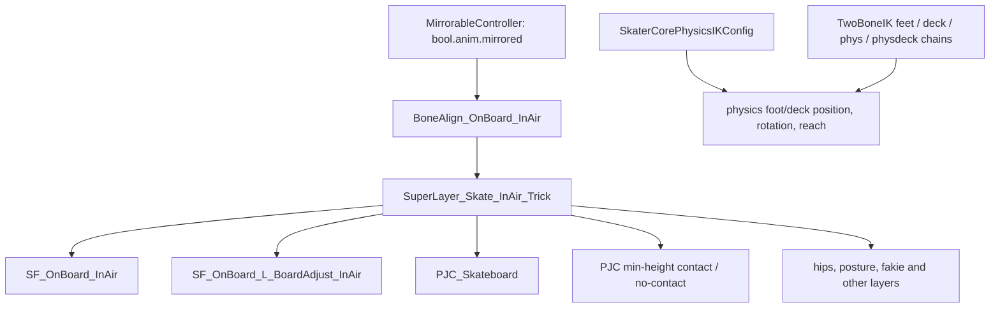

# Native animation investigation, 2026-10-19

Game executable SHA256: `fbce74d5e28ef525dbba2cb4adbebc13405bdbd88f31bc940bca45e4ae88b8f9`.
Read-only evidence comes from the isolated game's Data layer, using the repository's native
bundle and typed EBX readers. This investigation does not establish active runtime branches,
final GPU appearance, or a complete execution order of native rig operations.

## Reproducible inspection

Build `dingosdk_anim_graph_probe` with `DINGOSDK_BUILD_ANIMATION_STUDIO_TESTS=ON` on Windows:

```
dingosdk_anim_graph_probe GAME_ROOT OUTPUT_DIR animation/dingo/c_proto_onb_trick_o_kickflip_high animation/dingo/superlayer_skate_inair_trick
python contrib/animator-studio/summarize_native_graph.py OUTPUT_DIR SUMMARY_DIR [OLD_NATIVE_INDEX]
```

The probe scans the bundles in bam_levelroot, globals and dingolevel_root, decoding each
distinct animation/dingo name once. The first copy per name wins; this is not resolution of
every mounted mod or runtime asset override. It records partition GUID, root type, payload
SHA1, TOC and bundle. Requested documents retain typed fields, internal instance links and
external partition/instance GUIDs. Unresolved asset names remain null. Array/instance indices,
template slot IDs and serialized LayoutEntry offsets are never treated as live addresses.

The current run decoded **16,233 distinct assets**, with **41 selected documents**, no requested
asset missing and no decoding errors. There are 754 external reference fields in those
documents; 731 resolve to asset names in scope, 95 also resolve to selected exported instance
symbols. The older name-only index has 17,258 entries from a broader search; these counts
must not be presented as the same scope. The summary can enrich that older index with
verified root types, keeping unmatched entries unclassified and categories marked name hints.

## What the native data actually contains

The following is a dependency graph, not a measured execution sequence:



- `superlayer_skate_inair_trick_(mirrorable)` is a MirrorableControllerAsset, gated by
  `bool.anim.mirrored`; it wraps `bonealign_onboard_inair`, not a raw reflected clip. The
  bone-align controller declares lean, wallride, twist, head twist and direction chains.
  Equating this graph signal with our configured base stance or switch flag is not proven.
- `superlayer_skate_inair_trick` has `sf_onboard_inair` as its base and 11 layer entries,
  including board adjustment, procedural board controllers, minimum-height controllers,
  hip/posture additions and fakie weighting. The state-flow asset allows up to 3 active nodes.
  This capacity does not prove which nodes are active in any captured trick.
- `pjc_skateboard` declares procedural joint sets using model-space ankle effectors and
  a procedural skateboard-orientation signal. Its enable expression references held-flip
  and procedural-board states. The compiled expression kernel is preserved, not decompiled.
- The two min-height controllers reference `vec3.physics.skateboarddeckposition`, a reference
  joint and a weight signal. Their operation/space enums are preserved as raw numbers.
  A guessed board-to-foot vertical offset is not equivalent to these controllers.
- Separate two-bone chains target animation feet, deck effectors, physics feet and physics
  deck targets. The PhysDeck chain references target position, quaternion and reach from
  physics. SkaterCorePhysicsIKConfig binds these and contains foot locks and future positions.
- Grind lock-in uses `ptm_gate_grind_into`, has its own transitions, and writes
  `bool.anim.forcephysicsskateboard`. Entry from a trick uses a named branch window and an
  InertializationBlendAsset (raw BlendTime 8). Units/overrides and live weights need measurement.

## Clip tags lost by the current exporter

Kickflip high's controller has 59 instances. Besides sampled motion, it contains FootOnBoard,
branch-in/out windows, motion info and game-state curves. Its MotionInfoTag GUIDs resolve to
`DelMar_Motion_Info_Enum` values including:

| RuntimeName | raw StartLinkOffset | raw EndLinkOffset | raw LinkFlags |
| --- | ---: | ---: | ---: |
| TrickFromGround | 0 | 1 | 0 |
| TrickFromGround_Reselect | 0 | 12 | 0 |
| TrickFromGrind | 7 | 1 | 0 |
| TrickFromGrind_Reselect | 7 | 5 | 0 |
| DarkTrickBranchIn | 18 | 2 | 0 |
| TrickInAirIdle | 32 | 2 | 0 |
| TrickLanding | 44 | 0 | 32 |

This is a raw tag table. In particular EndLinkOffset is not established as an absolute end
frame for all flags. The clip declares FPS=60 and TickOffset=0; the exported library's inferred
landing at 0.733333 s numerically matches 44/60 in this case. One match does not validate the
first-local-minimum marker heuristic for other tricks or native branch semantics.

The raw FBX places Skateboard_Root directly under AITrajectory, like Hips. Reference is identity
and AITrajectory initially turns -90 degrees; the board's initial bind rotation is +90 degrees.
No pre/post-rotation fields appear on the inspected hips, feet or board. In our FK evaluation
of animation frame 0, feet are 0.172/0.208 m below the board in its local up axis; at t=0.5 they
are 0.054/0.143 m below. These are raw exported-pose measurements, not proof of the final
native rig's foot penetration, nor proof that exporter/importer conventions are fully validated.
The extracted constraints explain why a raw clip cannot simply be assumed a final posed trick.

## Confirmed local discontinuities corrected separately

1. Preview chose between captured jump and synthetic parabola at each displayed frame using a
   12 cm threshold. Crossing it could remove an entire synthetic arc instantly. Choose from
   the whole clip's airborne trajectory once; keep the decision through scrubbing and looping.
2. Board-shape/start/floor caches identified clips by recycled raw addresses. Geometry is now
   computed from immutable first-frame spans; the floor cache retains shared clip ownership.
3. Preview's vertical world offset was converted using a parent-local placement rotation.
   Convert through world placement so a rotated reference does not change the up direction.
4. Refining pop height could reselect another clip of the same trick and reset source time
   to takeoff. Retain the selected variant through that named episode; a newly named late flip
   can still be selected. Blank names cannot restart it. This is still a fallback episode
   policy, not use of the native branch windows above.

Regression tests and Release compilation cover these changes. Visual validation is pending.
They do not solve the missing native constraint/phase model.

## Required architecture changes

The current on_animation path evaluates a custom pose before subsequent native work, then
on_render copies that pending pose over a later native pose, accepting up to 100 ms of age.
The board is another publication with its own holder/frame. Correct generation ownership is
necessary but does not establish that both represent the same native evaluation. Pure finite
pose tests cannot prove contact correctness, frame correspondence or constraint preservation.

1. **Preserve source identity.** Separate raw authored clip, sampled constrained capture and
   additive edit layer. Save controller GUID/asset, rig mapping, board frame, tag/branch metadata,
   stance context and time-base provenance. Legacy files remain explicitly unknown. Do not
   silently relabel a native export as a rendered capture.
2. **Read native phase before replacing phase logic.** Resolve guarded native instance/layout
   access for active controller, clip time, mirror state, branch window, contact and IK weights.
   Correlate known flat tricks and rail entries/exits. Stop deriving phase solely from a display
   name plus ballistic airtime, and stop extending all grinds as one held airborne clip.
3. **Use one evaluated-frame contract.** A packet identifies entity/board generation, native
   evaluation identity, phase, source time, coordinate frame, and body/board ownership. Compose
   body and board through one placement transform. A stale packet must not replace a newer
   native pose just because its wall-clock age is below 100 ms.
4. **Keep native constraints available.** Apply supported edits at a verified stage with a
   declared bone/effector mask. Body edits, physical board control and authored board motion
   are separate capabilities. Post-IK bone replacement needs a deliberate contact-preserving
   solve; independently rotating the board without its body is not a general stance conversion.
5. **Make preview honest.** Raw motion inspection and native constrained preview are separate
   modes. The current floor/parabola/feet heuristics are visualization aids. Until the native
   phase/constraint path is reproduced, the editor cannot claim WYSIWYG gameplay for raw assets.
6. **Verify geometry and transitions.** Test untouched native-preset identity, body-to-board
   transform invariance under reference/placement changes, contact windows, phase continuity,
   same-evaluation body/board pairing and stale-packet rejection. Compare measured native and
   edited output through entry, catch, landing, grind lock-in/loop/exit, bail and respawn.

The offline graph probe is the foundation for this redesign, not completion of native runtime
reverse engineering. No new game-memory offsets or injected rig operations are introduced here.
