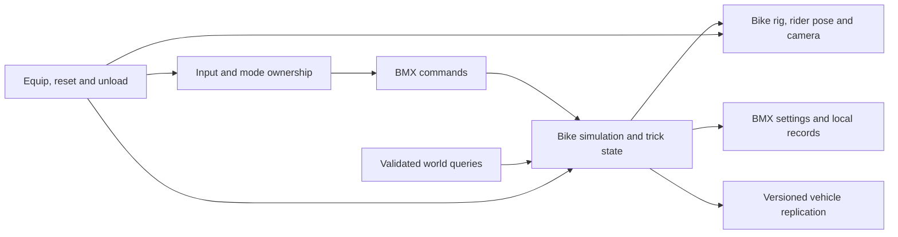

# BMX addition: feature and delivery plan

Current priority, 2026-10-18: physics and usable tricks; tire appearance is postponed.
Run 87 passed the measured native ramp route: supported ascent, continuous gravity-only
flight, settled two-wheel landing and braking inside the unchanged route boundary.
Run 88 passed the current Streets modifier/right-stick barspin and tailwhip requests,
airborne catches, one landed combo and left-stick pitch response in the native game.
Run 87 measured 59 client updates/s and 60 rendered frames/s after removing the rider/board
pose-write bottleneck; 9.0167 native seconds took 9.093 wall seconds. Skate D-pad inputs pass
through BMX capture. Physical controller acceptance and broader terrain coverage remain open.
Run 89 repeated the physical BMX/skateboard/walking round trip and same-body pause/resume:
six ordered states, three mounts, one body allocation and no pose drift during the pause.
Run 58 passed the first independent native chassis ride: 8.99 m COM travel, correct right
turn, physical braking, a .996 m hop and 541 force applications across 541 measured steps.
The native body supplies position, full rotation and velocities; tire/balance forces drive
the bike and the rider follows it. Run 59 verified same-pose pause/resume, native skateboard
switching, walking and three BMX mounts sharing one body allocation. The new backend is
explicitly selected with the isolated launcher flag `-NativeChassis`; the legacy adapter
remains available for comparison. Full controller feel and ramp coverage are still open.
See [physics backend investigation](bmx-lab/physics-backend-investigation.md).
Earlier physical-backend Run 62 passed the former neutral-rearmed rear-stick air pitch, full barspin/tailwhip rotations,
airborne catches, one landed combo and stable post-landing braking. Contact impulses
remain within the native force/torque limits; no bike pose or velocity clamp is used.
The isolated `-Ride` launcher now selects the physical backend automatically.

Earlier legacy-adapter status: Runs 52/53 verified native offline riding with all six world render parts,
correct right-turn direction and fresh owned rider poses, then the complete scripted
BMX/skateboard/BMX/walking/BMX cycle. The revised geometry and aligned crank pivot are included;
passive samples confirmed stock board bone-scale recovery. The user's Run 52 footage rejected
both bike and rider appearance: functional native checks passed, visual acceptance
failed. Run 53 passed corrected native integration and improved hand holding, but user feedback
identified grips floating below the actual bars and remaining tire-shading problems. Shared
authored grip anchors and direct normal encoding passed the Run 54 native mount/render smoke.
That run did not repeat riding or switching; corrected user images and full physical-control
acceptance remain required. Branch: `BMX`.
Source baseline: `9a011c041731a68cd1482f27292d8bf13a60058d`, reviewed 2026-10-16.

## Intended experience

Add BMX as an equipment choice alongside the skateboard, using the existing worlds, parks,
skater customization and ReSkate menus. The player can pedal through the city, pump transitions,
bunny hop obstacles, balance manuals, ride fakie, grind pegs and link aerial tricks. The bike and
rider should move together, and landing quality should matter.

Recommended default: approachable, momentum-based freestyle handling, with adjustable balance
and landing assists. Precision settings can make riding more demanding. These are proposed
product choices, not existing capabilities. BMX is off until selected and starts as an offline
experiment. Multiplayer becomes available only after its own compatibility milestone.

The earlier implementation in `Extension/BMX/` uses expiring input/motion ownership, a native
on-foot movement adapter, typed wheel/obstacle rays, six articulated native world entities and
guarded rider IK. Overlay bike drawing is disabled. The local asset pass extracted modular
geometry and targeted movement references from the user's BMX Streets install; those files
stay outside tracked source. Rider posture uses bounded cues on the Skate skeleton, not a full
Unity humanoid retarget or copied bike physics. The native adapter uses additive physics-step
timing and retains a 6 m/s forward cap and ray-based contact approximation. Earlier native
rehearsals moved the real rider 11.14 m, hopped 0.56 m, turned 0.244 radians and braked from
4.91 m/s to zero. Runs 33/35 used the older overlay presentation. Run 48 repeated these native
measurements with six ready world parts, 3,252 placements and zero overlay draw frames; its
right-stick phase produced signed native yaw -0.2438 radians. Its 540 render-pose writes ended
with a matching rider owner and a 16 ms old solved pose. Those measurements use synthetic
commands; physical bindings and visible quality need QA. Runs 49/50 repeated native riding with
the revised fork/saddle/pedals and final crank alignment. Run 40
verified actual native board state 100, the return to on-foot state 504/BMX control and walking
dismount, with 962 render-pose writes. It deliberately lacked bike blueprints: zero live parts,
placements and velocity updates, so it does not prove a complete bike ride or six-part cleanup.
Run 52 subsequently verified the complete ordered cycle: six live BMX parts/capture held,
zero parts/capture released with native board state 100, six parts/on-foot 504, walking with
zero parts/released capture, then six parts/on-foot 504 again. Motion/render/placement activity
resumed after both remounts; two board snapshots 8.050 seconds apart had unchanged counters.
Independent passive samples confirmed all 16 stock board scales recovered at observed native
100/103 endpoints, while roots stayed native-owned. This is scripted native evidence;
physical F6/controller input, rendered appearance and repeated unload coverage remain.
The [preserved user screenshot](../build/bmx-visual-feedback-20261017/before.png) and
[video contact sheet](../build/bmx-user-video/contact-sheet.jpg) show both wheels but pale tire
bands, compressed posture, flared elbows and open hanging hands. Run 52's tiny wrist/ankle
proxy errors did not validate visible grip or anatomy. The rider correction now uses the
rendered grip midpoint, mirrored hand orientation, actual native finger chains and adjusted
neutral hips/elbow poles; its focused source fixtures pass. The bike appearance comparison
separates flat atlas UVs with unchanged Run 52 tangent bytes from an additional normal-selection/
wheel-smoothing experiment. The [authored-normal match](../build/bmx-native-assets/material-audit/donor-source-normal-comparison.json)
now confirms the decoder on all 2,386 Frame vertices: dot minimum 0.999852 and mean 0.999994
against the original NORMAL attribute after position/exact-half-UV matching. Weak face-normal
alignment is present in the authored source, rather than a decoder discrepancy. Run 54 replaces
coarse code selection with a direct inverse encoder: independent literal-shader checks cover
6,224 inputs and all 125,820 generated vertices, including full-basis handedness and front/back
behavior. Generated normal/tangent errors are at most 0.1748°/0.1765°. Shaders and masks remain
unchanged; mask-channel meanings and desired rubber roughness are still unverified.

Run 53 passed native integration using combined B, but the user clarified that holding now
works while the grips themselves float below the bars. The
[canonical anchor include](../Extension/BMX/bmx_grip_anchors.inc) now drives both Python sleeves
and native hand targets about 44 mm above the old placement, with hand axes following the
actual swept tubes. The [source triangle-slice validation](../build/bmx-native-grip-attachment-tests.json)
passes both grips and rejects three detached/wrong-axis mutations. Run 54 mounted/rendered the
corrected anchors and direct encoder. The retained earlier A/B controls predate the new grip
fit; no new appearance result has been accepted.
Basic prototype riding is established; broader M0/M1 acceptance remains. See
[native-prototype.md](bmx-lab/native-prototype.md) for isolated setup and current limitations.

## Feature scope

| Area | First offline prototype | First complete BMX release | Later expansion |
| --- | --- | --- | --- |
| Equipment | One bike; explicit equip/unequip and safe reset | Mount/dismount, walk and remount, preserve skateboard selection | Multiple frame geometries and discipline presets |
| Riding | Pedal, coast, steer, rear brake; flat ground and basic ramps | Acceleration and grip tuning, pumping, banked turns, ramps, transfers, controlled slides | Moving platforms, advanced tire/material behavior |
| Balance | Stable two-wheel riding | Manuals, nose manuals, fakie, pivot and rollback transitions | Footjams, stoppies and advanced flatland |
| Hops and air | Preload/release bunny hop; predictable landing | Hop height control, pitch/roll/yaw, 180/360 and larger continuous spins | Flips, flairs and additional air techniques |
| Grinds | Deferred | Double-peg, feeble and smith; left/right entry, exit hop | Ice pick, toothpick, crankarm and additional ledge tricks |
| Trick animation | Basic riding and hopping poses | Barspin, tailwhip, tabletop and no-hander; combinations with spins | Opposite/double variants and additional trick packs |
| Bails | Collision stop and reliable reset | Rider/bike separation, validated ragdoll transition, recovery | Bike damage and wear |
| Presentation | Visible articulated bike; readable rider stance; chase camera | Pedal and wheel animation, contact effects, bike audio, trick HUD, customization | First-person cockpit camera and photo tools |
| Progression | Debug telemetry only | BMX trick naming, landing/combo rules, separate local bests and simple practice goals | Dedicated challenges, events and competition formats |
| Multiplayer | BMX unavailable in network sessions | Compatible BMX clients/servers; mixed bike/skate play within that version | Player collision, competitive synchronization improvements |
| Replay | Explicitly unsupported until proven | Record and play rider, bike and trick state together | Advanced editing and shareable BMX replay tools |

The complete release column is the intended feature set, not a promise that every feature can
use the game's existing systems. A blocked feature is explicitly deferred or redesigned before
the release scope changes. In particular, native skate challenges, Throwdowns and skate scoring
are not assumed to accept BMX. They stay unavailable while riding until adapted and tested.

## What the current source establishes

| Evidence in this checkout | What it makes reusable | Limit for BMX |
| --- | --- | --- |
| `Runtime/client_tick.cpp`; `Extension/BMX/bmx_runtime.cpp`; `bmx_native_motion.cpp` | Verified client update, expiring BMX movement/input ownership and native physics feed | Supported on-foot state only; broader terrain and lifecycle QA remain |
| `Extension/Skater/client_noclip.cpp` | Validated local body access and physics-step integration examples | Assumes 9 board bodies and 26 rig bodies; native board jumps can undo velocity changes |
| `Extension/Profile/local_profile_runtime.h`; `Extension/Profile/local_profile_objects.cpp` | Typed native hit/clear/unavailable probes, local-body exclusion | Successful query execution does not prove region streaming; rays approximate a bike envelope |
| `Extension/Objects/ParkEditor/park_editor_surface.h`; `Extension/Skater/drone_flight.h` | Native ray wrapper; examples of estimating a surface normal | Does not establish wheel contacts, swept chassis collision or moving-body response |
| `Extension/Multiplayer/Remote/native_prop.h`; `native_prop.cpp`; `Extension/BMX/bmx_world.cpp` | Six articulated native world models, generation guards and client-context creation/cleanup | Render parts do not add tire/chassis rigid-body collision; current pack needs live visual QA |
| `Extension/Multiplayer/Remote/native_skater.h`; `native_skater.cpp` | Additive animation/render-pose broker | BMX must retain the other observers and validate pose ownership |
| `Engine/Game/Input/bmx_input_sample.h`; `Extension/UI/Overlay/overlay_input.cpp`; `input_capture.cpp` | Normalized Xbox/PlayStation controls and an expiring BMX input-capture lease | Menus, prompts and other capture owners retain priority; ordinary riding still requires focus and release-to-rearm |
| `Extension/Multiplayer/Net/protocol.h`; `protocol.cpp`; `pose_codec.h` | Pose transport, validation and interpolation infrastructure | Protocol 52 is strictly versioned and its pose explicitly contains skater and skateboard data |
| `Extension/Skater/physics_tuning.h` | Existing tuning UI and host-policy patterns | Shared skate tuning is not a separate vehicle model and must not be globally repurposed for BMX |
| `assets/models/bmx/`; `contrib/bmx-lab/build_native_bike_pack.cpp` | Local geometry extraction and private six-part native model pack | Extracted geometry is ignored/local-only, not a redistributable release asset |
| `Engine/Core/Platform/user_data_paths.h`; launcher/runtime redirection and local-profile guards | Validated isolated development roots and fail-closed test writers | Ordinary defaults still share production data; overrides are not an OS filesystem sandbox |

The source pins Steam build `25414733` in `Engine/Game/Build/supported_build.h`. Keep that identity
check. New native contracts belong beside the existing build-specific contracts and need their
own validation. Source review does not prove behavior in the running game.

## Integration strategy and feasibility gates

Preferred direction: a ReSkate-owned bike controller and state model, connected to validated
engine collision, rendering and animation adapters. Keep its handling separate from skateboard
tuning. First compare this with a native vehicle path if a suitable one can be demonstrated.
Do not select a production physics backend just because a visual prop can be placed.

| Candidate | Potential benefit | Evidence required before selection |
| --- | --- | --- |
| Adapt native vehicle/rigid-body support | Engine contacts, collision and potentially natural bails | Demonstrate creation, ownership, constraints, update order, destruction and reproducible two-wheel behavior |
| ReSkate-owned bike dynamics with engine collision adapters | Explicit handling and a separately testable model | Demonstrate wheel support, reliable query readiness, chassis sweeps, player/pose control and lifecycle restoration |
| Reuse board movement with a bike visual | Fast visual experiment | Useful only as a labeled experiment; it does not meet the independent-wheel, rider-pose or handling requirements |

The following questions gate a rideable prototype:

1. Can BMX own local movement without the native skate controller moving the player again?
2. Can collision report **unavailable**, **clear** and **hit** distinctly, and support enough
   contact information to handle slopes, lips and obstacles? Collision-world readiness and
   streamed-region readiness need separate evidence; a clear ray alone proves neither.
3. Can a bike's frame, wheels, fork, bars and crank be rendered and articulated without replacing
   every player's skateboard mesh?
4. Can the local rider be posed consistently without animation rewriting it or breaking first
   person, replay, Board Break or remote skaters?
5. Can equip, unequip, respawn and level unload restore all acquired state safely?

Failure at a gate produces a recorded limitation and a revised design. A visual-only bike or a
flat-plane simulation may be useful research, but does not count as the rideable milestone.

## Proposed architecture

These paths and types are proposed additions, not existing APIs.

- `Engine/Game/BMX/`: plain bike state, geometry/tuning, input commands, balance, contact rules,
  trick recognition and serialization types. No game addresses or UI dependencies. Keep pure
  model tests here; collision queries are an injected interface.
- `Extension/BMX/`: equip lifecycle, physics integration, collision adapter, bike entity,
  rider animation, camera, audio and console requests. Connect through verified engine-thread
  entry points. Build-specific native contracts remain under `Engine/Game/Build/20260929/`.
- `Extension/UI/Overlay/bmx_page.cpp` and the native Mod Options menu: equipment choice,
  bindings, presets, assists, bike appearance and availability reasons. Presentation queues
  commands; it does not write physics or native poses directly.
- `Extension/Multiplayer/`: separate vehicle state/schema, capability handling, interpolation
  and remote bike entities. Share useful transport primitives while preserving board semantics.
- `assets/models/bmx/` and a reproducible content-pack builder: source model, rig metadata,
  attribution, textures, collision shapes and generated pack. Keep necessary export/build tools
  tracked; `/tools/` is currently ignored and cannot silently hold release-critical tooling.

Add a shared ownership/dispatch mechanism for input and pose hooks before BMX uses them. Decide
which features can compose and which are exclusive. Do not silently overwrite a registered
callback or assume spare physics-listener capacity.

Give simulation, client-update and animation/render threads explicit responsibilities. Queue
input requests, publish immutable state/pose snapshots, and keep native handles owned by their
adapter and actor generation. UI/render callbacks do not run collision or physics writes.

Lifecycle states: `disabled -> preparing -> mounted -> airborne/manual/grinding -> recovering`,
with explicit return to riding or disable. Walking/dismounted is a separate controlled state.
Any state can enter teardown on unload, entity replacement, lost contracts or rejected session
policy. State transitions clear held gestures and restore only resources BMX actually owns.
Teardown first stops simulation requests and releases input, then removes tracked bike entities
and restores native movement/camera only when their current owner identities still match.
Discard stale handles after actor replacement; recover through a newly validated context.

## Riding, contact and trick rules

- Simulate at a fixed timestep selected after profiling, driven by the game's simulation clock,
  pause, rate and `TimeScale` (`Engine/Game/Settings/simulation_time.h`). Interpolate rendering
  independently. Use bounded substeps/catch-up; clear/rebase accumulated time after pause, load
  and excessive stalls. Render frame rate must not change acceleration, hop height, balance or
  trick recognition, and slow motion must slow bike and rider together.
- Track front/rear wheel centers, radius, wheelbase, ground support, frame orientation, linear
  and angular motion, steering, crank phase and wheel phase. Geometry values are tunable design
  inputs, not implied by the existing skateboard skeleton.
- Model pedal acceleration, coasting drag, rear brake, speed-dependent steering, lateral grip,
  rider weight shift and balance assists. Start with a forgiving freestyle preset. Front brake
  and additional technical behavior follow only after the basic contact model is stable.
- Pump from rider load/unload through transitions; repeated input on flat ground must not create
  unlimited speed. Define bounded speed/energy behavior for each tuning preset.
- Query wheel support and sweep the frame/rider envelope against walls, rails and ground. Cap
  penetration correction and handle curb/lip transitions. Multiple rays can estimate a surface
  normal, but must be identified as an approximation and tested on edges and curved transitions.
- An unavailable or unstreamed world pauses movement or resets to a verified safe location.
  Never treat missing query capability as empty space. Dynamic props/moving platforms remain
  outside the initial validated collision scope.
- Bunny hops preload and release once, with front/rear lift timing and a bounded impulse.
  Balance and hop requests require valid supporting contacts; no repeated airborne hop.
- Manuals and nose manuals need the appropriate single wheel supported and a weight/balance
  window. Fakie uses signed rolling direction, with defined steering and pedal behavior.
- Grinds need peg/rail geometry, approach angle, alignment and contact continuity. Use explicit
  double-peg, feeble and smith states; do not rename a native skateboard grind and assume it is
  correct. A bad entry, incompatible rail or lost support exits or bails predictably.
- Tricks separate physical bike rotation from authored rider/bike animation. Count barspins and
  tailwhips only after their animations complete and hands/feet can recatch; interrupted or
  late tricks affect the landing. A flip animation alone does not make a landed trick.
- Track rotation continuously through takeoff, air and landing so 180/360/540/720 labels follow
  actual motion. Award combos only on valid landing; define sketchy landing and bail outcomes.
- Native ragdoll/bail reuse is a discovery task. If safe rider/bike separation cannot be proven,
  retain a clearly labeled reset-based prototype and keep full bail support as a release blocker.

## Bike assets, rider and presentation

Current source renders frame, fork, bars, front/rear wheels and cranks as native world entities.
Its rider pose maintains grip/pedal targets and adds bounded preload, weight and airborne cues.
[Recovered local references](bmx-lab/controls-and-reference.md) establish authored binding and
animation structure; they do not establish identical handling, complete retargeting or final
visual quality. The following items describe the complete-release target.

Start with one unbranded freestyle bike and the player's existing skater. The deliverable needs
more than a single static mesh:

- Independent frame, fork/steering, bars, front/rear wheels, crank and pedal transforms; stable
  pivots, scale, forward/up axes and attachment sockets for hands, feet, hips and pegs.
- Collision shapes separate from the render mesh; appropriate level of detail and material
  variants. Review bounds, wheel dimensions and rider reach together before tuning handling.
- Rider poses for idle, pedal/coast, turn/lean, preload, hop, air, manual, fakie, grind, landing,
  mount/dismount and bail. Use authored animation with inverse kinematics for hands on grips and
  feet on pedals; release contacts deliberately for barspins, whips and no-handers.
- Wheel spin follows rolling speed and contact/slip rules; crank follows pedaling rather than
  rotating whenever the bike moves. Steering visuals match the controller.
- A chase camera frames bike and rider, avoids walls, smooths landings and supports look-back.
  Offer adjustable distance, FOV, shake and automatic recentering. First person is a later option.
- Tire roll, freewheel, chain/pedal, hop/landing and peg-grind audio; muted or reduced effects
  options. Reuse material-aware effects only where the material identity is validated.
- Frame/fork/bar/grip/tire color choices initially; geometry-changing parts require matching
  collision, attachment and tuning data. Preserve current skater clothing and skateboard setup.
- Maintain source/attribution records and reproducible exports for every distributed asset.
  Do not assume the shipped drone pack includes a reusable exporter or BMX animation pipeline.

## Current bindings and planned accessibility

Updated to the requested front/rear split: **left stick owns handlebars/front end; right stick
owns the rear wheel and rear-end tricks**. Neither plain stick is a camera control. This replaces
the earlier face-button hop/right-stick-camera proposal. The current recognizer and synthetic
lab share core gestures and base A/B/R3 bindings. The native runtime adds Y dismount and guarded
equipment lifecycle. [Reference evidence](bmx-lab/controls-and-reference.md) separates observed
Streets bindings from the requested ReSkate trick adaptation and unfinished movement systems.

| Input | Grounded | In air |
| --- | --- | --- |
| Left stick X | Steer the handlebars | Body yaw |
| Left stick Y | Front-end weight input | Pitch/flip after an airborne neutral; diagonals combine with yaw |
| Right stick down then up | Preload and flick a bunny hop | No second hop |
| Partial right-stick down/up | Manual/nose-manual balance intent | Rear-end weight input |
| LB/L1 + right stick down | No airborne trick | Left barspin |
| RB/R1 + right stick down | No airborne trick | Right barspin |
| LT/L2 + RT/R2 + right stick left/right | No airborne trick | Left/right tailwhip |
| A / Cross | Pedal | No propulsion |
| B / Circle | Brake | No artificial midair slowdown |
| R3 | One quick hop per grounded press | No hop or queued landing impulse |
| Y / Triangle | Leave BMX for walking | Leave BMX for walking |
| F6 / `bmx toggle` | Runs 52/53 verified the full six-part native cycle using queued commands | Physical F6 input and repeated lifecycle/appearance QA remain |
| RT / LT | Reserved lean/lateral behavior; no propulsion/braking | Physical lean/air control unfinished |
| D-pad | Existing Skate mappings | Existing Skate mappings |
| Menu / Options | Existing ReSkate menu | Existing ReSkate menu |

Gestures require a centered-stick rearm and distinct ground/air context. The right stick can
rearm while a trick modifier remains held; steering alone never requests a barspin.
A hop consumes one down/up sequence. Menus,
focus loss, device loss and context changes clear pending gestures and require release before
rearming. The model emits trick **requests**, not proof of completion, catch or landing.

Pegs engage from valid approach/contact; an exit hop uses the regular right-stick hop gesture.
Camera orbit/look-back, body spin/roll, advanced trick modifiers, bail, mount and reset bindings
remain to be playtested without taking either plain stick away from its front/rear role.
Provide remapping and explicit keyboard trick actions so stick gestures are not the only input
method. Current no-pad native fallback uses WASD front, IJKL rear, E pedal, Q brake,
Z/C shoulder modifiers and 1/3 trigger modifiers.
Bike/skateboard switching status is tracked in the [native guide](bmx-lab/native-prototype.md);
it is separate from the Y walking dismount.

Reserve existing menu, chat, voice and system inputs. BMX owns riding inputs only while mounted.
Suspend skateboard grind-exit triggers and conflicting Trainer/boost/noclip bindings during
that ownership, with a visible reason; preserve their saved settings. Freecam, drone, replay
editing and BMX camera must have explicit ownership transitions. Opening a menu or losing
focus/controller connection clears pending pedal/hop/trick actions and reacquires only after
release. Online menu behavior must not freeze the shared world.

Resolve global menu/chat/voice and reserved Trainer chords (LB + RB + D-pad) before BMX modifiers.
When a global chord owns an input sequence, suppress BMX riding/trick actions for that
sequence and clear pending gestures; never trigger both owners from the same press.

Expose deadzones, sensitivity, steering response, hold/toggle pedaling, hop timing buffer,
manual/landing assists, camera shake, captions and optional balance/trick hints. Use names/icons
as well as color. Mark assisted/custom sessions in BMX records before any competitive modes.

## Persistence, sessions and replay

- Store versioned BMX preferences, selected bike, bindings and BMX records under BMX-owned keys.
  Use the existing transaction conventions. Preserve skate records, customization and tuning.
  Transient vehicle/pose/camera ownership is never restored blindly from a save.
- A separate source branch or game directory does not isolate the shared profile. Before a
  runtime experiment, design and verify an explicit test data root covering profile, game saves,
  settings and any feature files; inventory all writers. Use a verified closed-process backup
  for any data that must be shared. A single environment-variable change is not isolation proof.
- Keep the normal Steam installation separate from the BMX test game copy. Recheck the live
  supported-build identity and test paths rather than assuming the older local installation is
  still compatible. Do not let automatic updates replace the test DLL during a session.
- Offline milestones reject/disable BMX before entering or joining a network session. Late
  joins, invites and reconnects must pass through the same guard.
- Online BMX requires an explicit protocol/version change and vehicle capability/session policy.
  Existing clients strictly reject a different protocol version; graceful mixed-version join is
  not currently available. First online release uses matching BMX-aware client and server builds.
- Matching clients may mix skaters and BMX riders in one lobby. Replicate an equipment kind,
  bike/rig/tuning version, root motion, wheel/steering/crank state, rider pose, trick/bail state
  and lifecycle generation. Do not encode a bike into the existing skateboard bone array.
- Send equip/spawn/despawn/reset transitions reliably; use bounded movement snapshots with
  keyframe/delta recovery. Never transmit native addresses or accept an asset path as a type ID.
- Preserve client-authoritative motion initially, with server validation; this is not a new fully
  authoritative simulation. Define bounded sizes/rates, finite transforms, bike geometry and
  speed/acceleration envelopes, authorized turn/reset/teleport handling and stale-generation
  rejection. Adapt skateboard-specific checks for BMX. Retain the existing `Server/speed_check.h`
  clock-rate check for both equipment types: it detects accelerated game time, not travel speed.
  Introduce a separate bike movement envelope instead of weakening that clock check.
- Host/server owns allowed vehicles, assists and tuning policy. Remote interpolation handles
  jitter, loss, late join, equip changes, respawn and disconnect. Use non-solid remote bikes
  initially; player-to-player bike collision is deferred until ownership/abuse controls are proven.
- Keep tuning enforcement isolated: BMX host policy never overwrites skateboard tuning, and
  existing host/dedicated stock-skate enforcement never overwrites the BMX model.
- Required bike content is identified and validated before spawning. Missing or mismatched
  content gives a clear join/equip error; no automatic code execution or arbitrary remote assets.
- Replay needs a versioned BMX track for bike transforms/articulation, rider pose, trick events
  and equips. Prove capture hooks record after BMX pose changes; render-only edits or a separate
  prop may not be recorded by native replay. Test scrub, reverse, pause and slow motion. If native
  integration fails, assess a separate BMX replay track before advertising replay support.

## Delivery milestones and exit criteria

Milestones are ordered by dependency. Advance only when the evidence for the previous gate is
recorded; estimate calendar effort after feasibility work, when the controller, content pipeline
and pose ownership choices are known.

| Milestone | Concrete deliverable | Exit criteria |
| --- | --- | --- |
| M0: feasibility and isolated test setup | Reproducible Windows build setup; safe test data/game roots; recorded control, collision, articulated-model and rider-pose experiments; selected backend | Supported game fingerprint verified; toolchain builds stock baseline; model exports reproducibly; movement ownership, simulation clock/pause and teardown work; collision readiness/contact strategy demonstrated; remaining blockers listed |
| M1: rideable offline slice | One visible bike/rider, equip/unequip, pedal/coast/steer/brake, basic hop, chase camera, reset | Ride flat, slope and ramp test areas; land hops and hit walls without native skating fighting the bike; repeated equip/reset/unload restores skating; no production save writes |
| M2: complete core handling | Pumping, balance, manuals/nose manuals, fakie, refined air/landing, mount/dismount and bails | Predictable curb/lip/transition behavior; no airborne re-hop or unbounded pump speed; bike/rider separation and recovery validated; controller and keyboard parity |
| M3: tricks and grinds | Double-peg/feeble/smith, spins, barspin/tailwhip/tabletop/no-hander, trick HUD and separate BMX combos | Contact-based recognition; valid recatch/landing required; interrupted tricks/bails cancel scoring; left/right and fakie variants tested; native skate challenges remain isolated |
| M4: presentation and replay | Finished bike/rig, rider clips/IK, customization, audio/effects, tutorials/accessibility, BMX replay integration | Clothing/body-shape checks; hands/feet track correctly; camera occlusion works; recordings reproduce bike and rider on seek/reverse; test-save migration and rollback pass |
| M5: multiplayer beta | Versioned BMX protocol, compatible lobby/server policy, remote bikes/riders, validation and content checks | Two-client and dedicated-server tests; loss/jitter/reconnect/late join work; stale generations/epochs and unauthorized equip/tuning/reset requests rejected; mismatched versions/assets fail clearly; mixed equipment and tuning isolation work; remote bikes remain non-solid |
| M6: release candidate | Packaged runtime/content, user controls/setup guide, support matrix, known issues and rollback | All release-scope gates pass; regressions and performance comparison reviewed on the supported build; clean install/uninstall and update behavior verified |

M0 and M1 are separate checkpoints: a console switch, menu mockup or standalone simulation does
not satisfy M1. Likewise, a local bike moving on two screens does not by itself satisfy M5.

## Validation plan

| Layer | Required evidence |
| --- | --- |
| Pure model | Fixed-step behavior at 30/60/120+ render FPS with the same input timeline; finite/bounded state; braking/coasting; forward/fakie steering; balance windows; hop latch; pump energy bounds; trick completion/landing rules |
| Contact adapter | Flat/sloped/curved surfaces, curb, stair, rail, wall and ramp lip; thin obstacles at supported maximum speed; empty vs unavailable world; unload/streaming loss |
| Runtime lifecycle | Equip/dismount/reset repeated cycles; level reload and fast travel; respawn; pause/slow motion/stalls; menu/focus/device loss; stock skating restored; lost entity/contract stops further writes |
| Animation/assets | Bike pivots and wheel phase; steering/crank; hand/foot targets across body/clothing variation; all trick recatches; no global board replacement; clean content rebuild |
| Persistence | Scratch profiles; schema migration, unknown settings and interrupted writes; skateboard data unchanged; uninstall/rollback; inventory of all test data writers |
| Replay | Bike and rider stay synchronized through normal playback, seek/reverse, speed changes, equip, bail and unload |
| Network | Encode/decode limits; malformed/NaN/oversized input; version/rig/tuning mismatch; packet loss, reordering, jitter, reconnect, late join; old equipment/session/map/peer epochs rejected after despawn/travel/rejoin; unauthorized vehicle/tuning/reset changes rejected; mixed-equipment tuning isolation |
| Regression | Existing input/PlayStation, first-person, drone, Board Break, profile, pose/codec/prediction and server-check suites where affected; native skating and menus in game |
| Performance | Stock vs BMX on the same map/hardware: frame-time percentiles, simulation/query/pose cost, memory across lifecycle cycles, and online bytes/player/update; agree numeric budgets after baseline |

The focused CMake/CTest BMX option and deterministic model/ownership fixtures are implemented. Extend
existing tests at shared ownership and networking boundaries rather than only testing new helper
functions. Keep in-game tests distinct from CTest results: contact feel, animation, camera,
ragdoll and replay acceptance require the actual supported game and representative controllers.

Implementation verification: the approved MSVC toolchain at `C:\BuildTools\VS2022` builds the
native Release runtime/launcher. Portable and native fixtures have passed, including input
sampling, camera-relative steering, one-shot R3 hops, articulation, pose contacts and lifecycle
guards. Isolated native runs 33/35 passed real rider movement measurements; run 36 verified
ordinary ride startup. Those runs predate the six-world-entity presentation and newest pose/
controls/switch changes. Run 40 separately verified the native switching path with no bike
models. Run 48 passed the stricter native rehearsal with the real six-part pack: 11.1404 m,
0.5634 m hop, negative right-turn yaw, 4.91-to-zero braking, 541 velocity updates and 540 fresh
render-pose writes. Its [report](../build/bmx-native-run48-selftest.json) records 9.0167 native
seconds, no overlay draws and zero background time despite the unattended request. The native
subset-category repair was isolated from geometry changes and passed an independent byte audit.
All 23 BMX CTest fixtures passed in the final [handoff test log](../build/bmx-native-handoff-ctest.log).
Re-run after integration; these results do not validate pixels or physical controller feel.
Run 52's [ride report](../build/bmx-native-run52-selftest.json) passed with the revised geometry/
final crank pivot, 541 fresh render-pose writes and final pose age 16 ms over 9.0167 native
seconds. Its [switch report](../build/bmx-native-run52-switch-evidence.json) passed every
ordered phase and native activity check: six parts → board 100/zero parts → six parts/504 →
walking/zero parts → six parts/504. The final status retained capture with 9,960 placements
and 1,659 render writes. Two board snapshots 8.050 seconds apart had identical counters.
Fresh native board state comes from the transition-completion guard and independent passive
samples, rather than idle status alone. The [scale report](../build/bmx-native-run52-board-scale-evidence.json)
records unit roots in all 93 coherent samples and all 16 unit scales in 16 native board samples.
Earlier [Run 50](../build/bmx-native-run50-switch-evidence.json) and
[Run 51](../build/bmx-native-run51-switch-evidence.json) switch failures remain preserved;
an earlier riding pass was not substituted for the full cycle. Run 52's runtime SHA-256 is
`cdc3dce0f9f9705fa803eece72e16c04fb809f2e5fe1afa8d5bf2dc397919ad3`.
The [combined validation record](../build/bmx-native-final-validation.json) retains the exact
ride/switch/scale/build artifacts and a production-profile audit with 919 before/after files
and zero path/size/mtime changes. This is a metadata comparison, not a filesystem sandbox.
These functional reports predate the user's failed visual review. Updated grip fixtures compare
the palm proxy with literal rendered tube endpoints through the actual handlebar matrix and
check mirrored finger closure/clearance, but do not establish skinned hand shape or pixels.

Run 53's [corrective validation record](../build/bmx-native-visual-fix-validation.json) records
all 23 fixtures passing and native integration of the palm/finger/posture and B appearance
changes. Its [ride report](../build/bmx-native-run53-selftest.json) passed with six parts,
541 velocity updates, 539 fresh render poses and a final pose age of 15 ms over 9.0167 native
seconds. Palm-proxy error was below 0.000031 m; ankle-target error was zero. The
[switch report](../build/bmx-native-run53-switch-evidence.json) passed all 11 checks, including
the complete ordered cycle and board counters unchanged for 8.047 seconds. Final status
retained six parts/capture with 12,900 placements and 2,147 render writes. Runtime SHA-256:
`01f53e54a988b551d0727a880f16536ebb50197e1aa027e8c78a4d1bb919fc10`.
These corrected functional results do not supersede the user's appearance feedback. Run 53
improved holding but still left grips floating below bars and tire shading wrong.

Run 54's [mount/render record](../build/bmx-native-run54-validation.json) identifies runtime
`b50864bd1a59b9654134b95a9453089e96e5987b0b89c763bcb3f9641577fd4e` and pack
`generated-29fef719c8594fd1a9f9c5c1d1293a07`. At 21:23:11.815 it recorded grounded native 504,
six parts/capture held, 1,848 placements, 614 pose writes and 307 render writes, with palm-proxy
error rounded to 0.000031 m and ankle-target error zero. All 23 fixtures passed and 18 generated
part files matched reviewed outputs byte for byte. This was `-Ride` mount/status smoke only,
with no synthetic riding or equipment-switch sequence. Run 53 retains that separate functional
evidence; new Run 54 pixels remain pending user inspection.
See [the native guide](bmx-lab/native-prototype.md) and [setup record](bmx-lab/msvc-setup-plan.md).

## Main risks and decisions

| Risk | Response / decision gate |
| --- | --- |
| Native skating rewrites bike motion | Prove exclusive simulation ownership at M0; reject a per-frame teleport workaround for the final feature |
| Incomplete collision data causes fall-through or bad transitions | Separate query readiness from miss; prove contact/sweep strategy and supported surface scope before M1 |
| Model/animation pipeline is unavailable | Rebuild one articulated test asset from tracked sources at M0 before committing to the final rig |
| Existing hooks are overwritten | Add shared dispatch/ownership and restoration tests before enabling BMX |
| Rider anatomy/animation fights bike pose | Validate layered pose/IK and native update order; retain an explicit blocker if it cannot be made stable |
| Shared profile or updater changes test behavior | Verify all data roots, closed-process backups and test update policy before running the experimental DLL |
| Native replay omits a prop or late pose edit | Prove recording order; design a BMX track or explicitly defer replay before release scope is accepted |
| Network and anti-cheat still assume a skateboard | Separate vehicle schema and matching-version rollout; retain bounded validation with BMX-specific rules |
| Feature count outpaces a stable bike | Ship checkpoints; defer advanced tricks, damage, first person and dynamic/player collision until their prerequisites pass |

Recommended defaults for continued implementation: approachable freestyle, one bike,
existing rider customization, offline first, separate movement/tuning, controller and keyboard
support, and matching-version multiplayer later. Isolated native prototype riding is now
demonstrated with all six render entities, and Runs 52/53 passed the full scripted equipment cycle.
Visible model/pose quality failed the user's Run 52 review. Run 53 improved holding, but the
floating-grip geometry and tire appearance still need corrected in-game images.
Physical controls, shoe-sole orientation and materials still need live acceptance.
Pedal platform normals currently rotate with the crank, so shoe alignment is
approximate. Broader surface, lifecycle, visual and performance coverage is required before
closing M0/M1.
